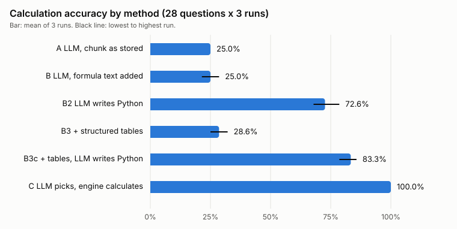

## DNV 규정 RAG

**데모: https://jo0hk.github.io/DNV_RULE_FINDER/** · **실험 결과: https://jo0hk.github.io/DNV_RULE_FINDER/results.html**

도면 수정 사항이나 문제 사항을 영어 문장으로 입력하면, DNV 선급 규정에서
관련 조항을 찾아 답변 + 근거 조항·페이지를 영어로 출력합니다.
문장에 수치를 넣으면 해당 DNV 공식으로 계산해 단계별 계산 표를 보여 줍니다.
한글이 들어간 문장은 받지 않습니다.
웹 화면과 터미널 두 가지로 쓸 수 있습니다.

| 입력 예 | 결과 |
|---|---|
| Bilge plate thickness modified to be thinner than the adjacent bottom plate | 관련 조항 답변 + 출처 카드 |
| Required net plate thickness: longitudinally stiffened bottom plating, 120 kN/m2, panel 3200 x 780 mm, A32 steel, no hull girder stress, AC-I | t = 8.504 mm, 계산 단계 표와 근거 조항 (Pt.3 Ch.6 Sec.4 [1.1.1]) |

## 동작 원리

```
[ingest.py]  PDF ─▶ 텍스트 추출 ─▶ 조항 단위 chunk ─▶ 임베딩 ─▶ Chroma DB
[tables.py]  PDF ─▶ 표를 구조 그대로 추출 (병합 칸 채움, 페이지 걸친 표 이어 붙임) ─▶ chunk와 연결
[rag.py]     입력 문장(영어) ─▶ 벡터 검색 + 키워드 검색 ─▶ 순위 합치기(RRF)
             ─▶ 상위 6개 발췌문 + 연결된 표 + 문장을 LLM에 전달 ─▶ 답변 + 출처
[calc.py]    입력 문장 ─▶ LLM은 공식 선택과 값 추출만 ─▶ formulas 엔진이 계산 ─▶ 단계별 결과
[server.py]  화면(web/) ◀─▶ /api/search, /api/answer, /api/calc
```

1. 텍스트 추출 (PyMuPDF): 표지·목차·개정 이력 페이지와 바닥글·워터마크는 제외합니다.
2. 조항 단위 chunk: 글자 크기 13pt인 줄을 제목(`2 Special requirements`, `2.1 Bilge plating`)으로
   인식해 제목이 바뀔 때마다 자르고, 길면 조항(`2.1.3`) 경계에서 약 1,000자 단위로 나눕니다.
   각 chunk 첫 줄에 `DNV-RU-SHIP Pt.3 Ch.6 Sec.4 [2.1] | 장 제목 > 절 제목 > ...` 을 붙여
   어느 문서의 어느 조항인지 알 수 있게 했습니다.
3. 임베딩 (bge-small-en-v1.5, 로컬 실행): chunk를 384차원 벡터로 바꿔 Chroma에 저장합니다.
4. 검색: 문서와 임베딩 모델이 영어 전용이라 입력도 영어만 받습니다. 입력 문장을 그대로 검색어로 써서,
   의미가 비슷한 chunk를 찾는 벡터 검색과 같은 단어가 들어 있는 chunk를 찾는 키워드 검색(BM25)을 함께 씁니다.
   조항 번호·강재 등급처럼 정확한 단어가 중요한 규정 문서에서는 둘을 합치는 편이 안정적입니다.
5. 표·텍스트 결합 RAG: chunk는 PDF 표를 줄글로 펼쳐 저장해 행·열 구조가 깨집니다. 그래서 표 917개를
   구조 그대로 따로 뽑아 두고, chunk 본문의 "Table N" 언급과 같은 조항 기준으로 연결합니다.
   검색된 chunk와 연결된 표를 함께 LLM에 넘기고, 화면의 출처 카드에서도 펼쳐 볼 수 있습니다.
6. 답변 생성: "발췌문에 있는 내용만 쓰고, 없으면 못 찾았다고 말하고, 근거 조항을 표시하고, 영어로 답하라"고 지시합니다.
7. 공식 계산: 규정 PDF의 공식은 이미지라 텍스트로 추출되지 않습니다. Pt.3 공식 6개를 PDF 원문에서
   옮겨 파이썬으로 구현하고(`formulas/`), PDF와 직접 대조해 검증했습니다. LLM은 함수 호출로 공식과
   입력값(단위 환산, 강재 등급 → 항복강도 포함)만 고르고, 계산과 적용 범위 검사는 엔진이 합니다.
   값이 빠졌거나 범위 밖이면 계산하지 않고 무엇이 필요한지 알려 줍니다.

| 구현한 공식 | 근거 조항 |
|---|---|
| 재료계수 k | Pt.3 Ch.3 Sec.1 [2.2] |
| 최소 판 두께 | Pt.3 Ch.6 Sec.3 [1.1.1] |
| 횡압력을 받는 판 두께 | Pt.3 Ch.6 Sec.4 [1.1.1] |
| 보강재 단면계수 | Pt.3 Ch.6 Sec.5 [1.1.2] |
| 선체 최소 단면계수 | Pt.3 Ch.5 Sec.2 [1.3] |
| 선체 최소 관성모멘트 | Pt.3 Ch.5 Sec.2 [1.5.2] |

## 실험 결과

### 계산은 누가 해야 하나

설계자 말투의 계산 문제 28개(값이 빠졌거나 범위 밖이라 거부해야 하는 문제 4개 포함)를 3회씩 풀게 했습니다.
정답과 1% 이내면 맞음입니다. 모델은 모두 gemini-3.5-flash-lite이고, A~B3c에는 필요한 규정 발췌문을 모두 줬습니다.

| 조건 | LLM이 보는 것 / 계산하는 쪽 | 정확도 | hard 문제 | 지어낸 값 |
|---|---|---|---|---|
| A | 저장된 chunk 그대로 (공식 없음) / LLM | 25.0% | 0% | 0/12 |
| B | chunk + 공식 텍스트 / LLM | 25.0% | 0% | 1/12 |
| B2 | chunk + 공식 텍스트 / LLM이 쓴 코드 | 72.6% | 59.3% | 0/12 |
| B3 | chunk + 공식 텍스트 + 구조화된 표 / LLM | 28.6% | 0% | 2/12 |
| B3c | chunk + 공식 텍스트 + 구조화된 표 / LLM이 쓴 코드 | 83.3% | 66.7% | 0/12 |
| **C** | **공식 함수 정의 / 검증한 파이썬 엔진 (서비스 방식)** | **100%** | **100%** | **0/12** |



- 공식이 빠진 chunk로는 계산할 수 없고(A), 공식을 텍스트로 줘도 LLM이 직접 계산하면 숫자를 지어냅니다(B, B3).
- LLM이 코드를 쓰게 하면 크게 나아지고, 표·텍스트 결합 RAG를 더하면 표 오독과 단위 실수가 사라졌습니다(B2 → B3c).
- 남은 오류는 계수 표의 경우 나누기 같은 조건 분기였고, 검증한 엔진(C)만 모든 문제를 맞히고 잘못된 요청을 모두 거부했습니다.

### 검색 정확도

정답 조항을 정해 둔 평가 질문 80개 기준, 서비스 방식(하이브리드 검색)의 결과입니다.

| 임베딩 모델 | R@1 | R@6 (LLM에 넘기는 범위) | MRR@10 |
|---|---|---|---|
| bge-small-en-v1.5 (서비스) | 0.625 | 0.912 | 0.736 |
| DNV 질문 12,169쌍으로 미세조정 | 0.650 | 0.912 | 0.752 |

미세조정은 차이가 오차 범위(1문항 = 1.25%p)라 서비스에는 적용하지 않았습니다.

## 문서

- [수식 하드코딩과 표·텍스트 결합 RAG 과제 정리](docs/assignment-formula-rag.md)
- [평가 세트와 검색 모델 학습 정리](docs/progress-2026-11-06.md)
