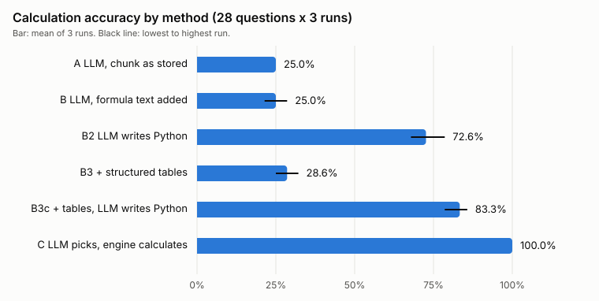
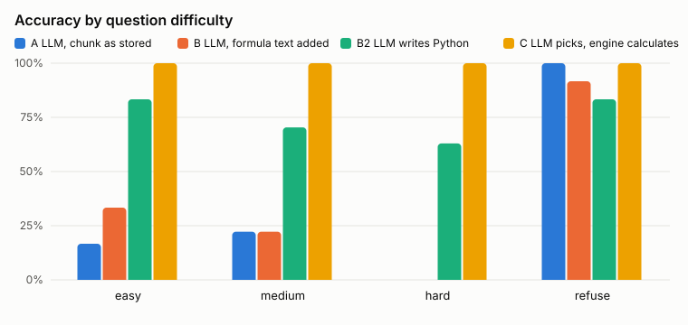

# 과제 정리: DNV 수식 하드코딩과 표·텍스트 결합 RAG

- 작성: 2026-11-13
- 이전 단계(평가 세트, 검색 모델 학습): [progress-2026-11-06.md](progress-2026-11-06.md)

## 과제 내용

| 과제 항목 | 한 일 | 결과 |
|---|---|---|
| DNV 수식 하드코딩 | Pt.3 공식 6개와 계수 표를 PDF 원문에서 옮겨 파이썬으로 구현했다 | `formulas/` |
| 수식이 잘 됐는지 확인 (직접 검증) | PDF 원문과 코드를 나란히 놓은 검증표를 만들고 직접 대조했다. 표 값은 자동 대조, 계산은 손계산 테스트로 확인했다 | 검증 완료, 테스트 24개 통과 |
| 계산할 때 이 파이썬 파일을 쓰도록 지정 | 공식 6개를 LLM 함수로 등록해 LLM은 공식 선택과 값 추출만, 계산은 엔진이 하게 했다 | `calc.py`, 계산 문제 28개 전부 정답 |
| chunk 방식과 LLM 방식의 성능 차이 확인 | 같은 계산 문제를 6가지 조건으로 3회씩 풀게 해 비교했다 | chunk만 25%, 하드코딩 엔진 100% |
| 다른 방식의 RAG 녹이기 | 표·텍스트 결합 RAG를 만들었다 (PDF 표를 구조 그대로 추출해 본문 chunk와 연결) | LLM 코드 작성 방식 72.6% → 83.3% |

## 진행 순서

| 순서 | 단계 | 이 순서로 한 이유 |
|---|---|---|
| 1 | 수식 검증 | 이후 모든 비교의 정답 기준이므로 먼저 확정해야 했다 |
| 2 | 계산 문제 세트 | 비교 실험의 채점 기준 |
| 3 | 계산 연결 (함수 호출) | 비교 실험의 조건 C |
| 4 | 성능 비교 실험 | 과제의 핵심 결과 |
| 5 | 표·텍스트 결합 RAG | 4번 실험 틀을 그대로 써서 효과를 비교할 수 있다 |
| 6 | 웹 화면 연결 | 결과가 다 나온 뒤에 한 번에 반영했다 |

## 1. 수식 하드코딩과 검증

### 왜 하드코딩인가

규정 PDF의 공식은 이미지라서 텍스트로 추출되지 않는다. 지금 DB의 chunk는 공식 자리가 비어 있다. 예를 들어 판 두께 조항은 "given by:" 바로 다음이 "where:"이고, Cw 정의는 "for L < 90"만 있고 식이 없다. 그래서 공식은 사람이 PDF를 보고 옮겨야 한다.

### 옮긴 공식

| 공식 | 근거 조항 | 결과 | 비고 |
|---|---|---|---|
| 재료계수 k | Pt.3 Ch.3 Sec.1 [2.2] Table 2 | k | 중간 값 선형 보간, 390 N/mm2는 피로 평가 여부로 0.66/0.68 |
| 최소 판 두께 | Pt.3 Ch.6 Sec.3 [1.1.1] Table 1 | t (mm, net) | L2 = min(L, 300) |
| 횡압력을 받는 판 두께 | Pt.3 Ch.6 Sec.4 [1.1.1] Table 1 | t (mm, net) | alpha_p 상한 1.0, C_a 상한 C_a-max |
| 보강재 단면계수 | Pt.3 Ch.6 Sec.5 [1.1.2] Table 3~5 | Z (cm3, net) | Table 3의 C_s 8가지 경우 |
| 선체 최소 단면계수 | Pt.3 Ch.5 Sec.2 [1.3] | Z (m3, gross) | C_w0는 L 90 m 기준 분기 |
| 선체 최소 관성모멘트 | Pt.3 Ch.5 Sec.2 [1.5.2] | I (m4, gross) | L > 90 m에만 적용 |

보조 정의는 다른 장에서 옮겼다. C_w는 Ch.4 Sec.4, f_r은 Ch.4 Sec.3, L2와 단위는 Ch.1 Sec.4에서 가져왔다. 공식 하나에 필요한 정의가 4~5곳에 흩어져 있었다.

### 엔진 구조

| 파일 | 역할 |
|---|---|
| `formulas/hull.py` | 공식 6개와 규정 표 값. 머리 주석에 PDF 쪽 번호와 Edition |
| `formulas/core.py` | 입력 정의(기호, 단위, 범위, 선택지), 계산 단계, 결과 구조 |
| `formulas/__init__.py` | `calculate("공식", 값...)`, `describe()` |

- 결과는 최종 값만이 아니라 단계마다 "기호, 식, 숫자 대입, 값, 단위, 근거 조항"을 남긴다. 화면의 계산 표가 이것이다.
- 적용 범위를 벗어난 입력은 오류로 막는다. 예: R_eH 460 초과, 관성모멘트에서 L 90 m 이하.
- 코드가 다루지 않는 각주나 조건은 결과에 메모로 붙인다. 예: 부식 여유 미포함, 모든 하중 조건 중 최댓값 필요.

### 검증 방법

| 방법 | 내용 | 결과 |
|---|---|---|
| 검증표 (`verify/build_sheet.py`) | 공식마다 PDF 원문 페이지, 옮긴 수식, 예제 계산, 코드를 한 화면에 놓고 확인 항목 31개를 체크 | 직접 대조 완료 |
| 표 값 자동 대조 | PDF 표를 프로그램으로 추출해 코드의 표 값과 비교. 일부러 값을 틀리게 바꾸면 불일치로 잡히는 것도 확인 | 표 5개 모두 일치 |
| 손계산 테스트 (`tests/test_formulas.py`) | 규정 식에 숫자를 넣어 손으로 계산한 값과 비교 | 24개 통과 |

## 2. 계산 문제 세트

설계자 말투의 영어 계산 문제 28개를 만들었다(`eval/calc_questions.jsonl`). 정답은 검증한 엔진으로 계산했고, 7개는 따로 손계산해 확인했다.

| 난이도 | 개수 | 내용 |
|---|---|---|
| easy | 6 | 필요한 값을 기호와 단위 그대로 준다 |
| medium | 9 | 강재 등급(D36 등)처럼 표를 거쳐야 하는 값, 설계자 말투 |
| hard | 9 | 단위 환산(0.15 N/mm2 → 150 kN/m2), 응력 부호와 압력 쪽에 따른 분기, L2 상한 |
| refuse | 4 | 값이 빠졌거나(압력, 방형계수) 적용 범위 밖(R_eH 500, L 80 m 관성모멘트)이라 계산하면 안 되는 문제 |

정답과 상대오차 1% 이내면 맞음으로 채점했다. refuse 문제는 계산하지 않고 거부해야 맞고, 숫자를 내면 "지어낸 값"으로 기록했다.

## 3. 계산 연결: 계산은 반드시 파이썬 엔진으로

```
설계자 문장 → LLM(함수 호출) → 공식 선택 + 값 추출 → formulas 엔진 계산 → 단계별 결과 표
```

| 장치 | 내용 |
|---|---|
| 함수 등록 | 공식 6개의 입력 정의를 그대로 LLM 함수 정의(JSON schema)로 바꿨다. 단위와 범위가 설명에 들어간다 |
| 자유 답변 금지 | 함수 호출 강제 모드(ANY)를 써서 LLM이 직접 숫자를 답할 수 없다 |
| 거부 함수 | 값이 빠졌거나 범위 밖이면 `cannot_calculate`를 호출한다. 계산 요청이 아닌 문장도 여기서 걸러 화면에 계산 패널을 띄우지 않는다 |
| 이중 검사 | LLM이 범위 밖 값으로 함수를 불러도 엔진이 다시 막는다 |

LLM이 하는 일은 공식 고르기, 단위 환산, 강재 등급 → 항복강도 변환뿐이다.

## 4. 성능 비교 실험

### 조건

모든 조건에 같은 모델(gemini-3.5-flash-lite)을 썼다. A~B3c에는 공식 6개에 필요한 규정 발췌문 15개를 모두 줬다. 검색 오류의 영향을 빼고 "계산을 누가, 무엇을 보고 하느냐"만 비교하기 위해서다.

| 조건 | LLM이 보는 것 | 계산하는 쪽 |
|---|---|---|
| A | DB에 저장된 chunk 그대로 (공식 없음) | LLM |
| B | chunk + 공식 텍스트 | LLM |
| B2 | chunk + 공식 텍스트 | LLM이 쓴 파이썬 코드 |
| B3 | chunk + 공식 텍스트 + 구조화된 표 | LLM |
| B3c | chunk + 공식 텍스트 + 구조화된 표 | LLM이 쓴 파이썬 코드 |
| C | 공식 6개 함수 정의 | 검증한 파이썬 엔진 |

### 결과 (28문제 x 3회)

| 조건 | 전체 (회차 최저~최고) | easy | medium | hard | refuse | 지어낸 값 | 평균 시간 |
|---|---|---|---|---|---|---|---|
| A | 25.0% (25~25) | 16.7% | 22.2% | 0.0% | 100% | 0/12 | 1.8초 |
| B | 25.0% (21~29) | 16.7% | 25.9% | 0.0% | 91.7% | 1/12 | 1.7초 |
| B2 | 72.6% (68~79) | 66.7% | 88.9% | 59.3% | 75.0% | 0/12 | 2.9초 |
| B3 | 28.6% (25~32) | 44.4% | 22.2% | 0.0% | 83.3% | 2/12 | 1.8초 |
| B3c | 83.3% (79~86) | 88.9% | 100% | 66.7% | 75.0% | 0/12 | 2.4초 |
| **C** | **100% (100~100)** | 100% | 100% | 100% | 100% | 0/12 | 1.6초 |





### 틀린 이유

| 조건 | 주된 오류 | 예 |
|---|---|---|
| A | 공식이 없어 대부분 거부했다. 맞힌 것은 표만 읽으면 되는 재료계수 문제뿐이었다 | |
| B, B3 | LLM이 직접 계산하면 숫자를 지어낸다 | 서로 다른 판 두께 문제 11개에 같은 값 11.23 |
| B2 | 표 오독 | 병합 칸 a = 4.0을 6.0으로 읽음 |
| B2 | 단위 실수 | 간격 700 mm를 0.7(m)로 넣어 302.3 cm3가 0.3 |
| B2 (1차) | 기호 오독 | `L2`(L, 300 m 상한)를 L의 제곱으로 읽어 10.06 mm가 1006 mm |
| B3c | 조건 분기 논리 | 보강재 C_s에서 f_m을 곱해야 하는 경우를 놓침, L > 300 m를 범위 밖으로 잘못 거부 |

B2의 기호 오독은 공식을 텍스트로 옮길 때 아래첨자를 `L2`처럼 붙여 쓴 표기 탓도 있었다. 표기를 `L_2`, 곱셈 `*`로 고쳐 B, B2를 다시 돌렸고, 위 표는 고친 뒤의 결과다. 1차 결과(B 27.4%, B2 72.6%)는 `eval/results/archive/`에 남겼다.

### 해석

| 결론 | 근거 |
|---|---|
| 공식이 이미지인 문서는 chunk만으로 계산할 수 없다 | A 25% (값 문제는 표 읽기 문제만 정답) |
| 공식을 텍스트로 줘도 LLM의 직접 계산은 믿을 수 없다 | B 25%, B3 28.6%, 지어낸 숫자 반복 |
| 코드로 계산하게 하면 크게 나아지지만 틀려도 그럴듯해 보인다 | B2 72.6%, 오류 없이 실행되는 잘못된 값 |
| 조건 분기와 범위 검사는 사람이 검증한 코드가 확실하다 | C만 100%, 거부 문제도 모두 정확 |

## 5. 다른 방식의 RAG: 표·텍스트 결합 RAG

### 문제

지금 chunk는 PDF 표를 줄글로 펼쳐 저장한다. 병합된 칸은 한 번만 나오고, 페이지가 넘어가면 머리줄이 다시 끼어든다. 그래서 LLM이 "AC-I, 종방향 보강판의 beta_a"처럼 행과 열을 맞춰 값을 찾기 어렵다. B2의 표 오독(a = 6.0)이 실제로 이렇게 생겼다.

### 방법 (`tables.py`)

| 단계 | 내용 |
|---|---|
| 표 추출 | PyMuPDF `find_tables()`로 페이지마다 표를 찾는다 |
| 병합 칸 | PDF가 알려 주는 칸 상자가 실제로 덮는 자리에만 같은 글을 채운다. 가로 병합은 옆으로, 세로 병합은 아래로 |
| 페이지에 걸친 표 | 제목 없이 다음 페이지 맨 위에서 이어지는 표를 붙이고, 열 구성이 다르면 머리줄 이름으로 맞춘다 |
| 제목과 소속 | 표 위의 "Table N 제목"을 붙이고, 제목이 들어 있는 chunk의 조항을 표의 소속으로 한다 |
| 연결 | chunk 본문의 "Table 1", "Sec.1 Table 2" 등을 (Pt, Ch, Sec, 번호)로 풀어 찾고, 같은 조항 안의 표도 연결한다 |
| 검색에 사용 | chunk가 검색되면 연결된 표를 함께 LLM에 넘긴다 |

처음에는 빈칸을 위 값으로 채웠는데, 최소 두께 표의 "Elsewhere"가 Deck 행으로 잘못 내려가는 문제가 있었다. 칸 상자 기준으로 바꿔 해결했다.

### 추출 결과

| 항목 | 값 |
|---|---|
| 추출한 표 | 917개 (Part 2: 261, Part 3: 300, Part 5: 356) |
| 제목(Table N)까지 인식 | 638개 |
| 여러 페이지에 걸쳐 이어 붙인 표 | 247개 |
| chunk의 "Table N" 언급이 실제 표와 이어진 비율 | 84% (1,152곳 중 963곳) |
| 처리 시간 | 약 3분 |
| 품질 확인 (`tests/test_tables.py`) | 검증한 공식 엔진의 표 값과 비교. 재료계수, 최소 두께, 판 계수, 보강재 Table 4·5, 기호표 모두 일치 |

이어지지 않은 언급은 대부분 저장소에 없는 Part(Pt.4)를 가리키거나 표 제목을 인식하지 못한 경우다.

### 효과

| 비교 | 결과 |
|---|---|
| LLM 코드 작성: B2 → B3c | 72.6% → 83.3% (+10.7%p) |
| 표 오독 (c06) | B2 3회 모두 틀림 → B3c 모두 정답 |
| 단위 실수 (c13, c16, c17) | B2 5회 틀림 → B3c 모두 정답 |
| LLM 직접 계산: B → B3 | 25.0% → 28.6% (계산 단계에서 틀려서 효과가 작다) |

단위 실수가 사라진 것은 구조화된 표 중 단위표(Ch.1 Sec.4 Table 5)가 함께 들어간 덕분으로 추정한다. B2와 B3c의 회차 범위(68~79%, 79~86%)가 79%에서 겹치므로, 개선 방향은 분명하지만 크기는 문제 28개 기준이라 신중하게 봐야 한다.

## 6. 서비스 반영

| 기능 | 내용 |
|---|---|
| `/api/calc` | 계산 질문이면 엔진의 단계별 결과를 돌려준다 (조건 C 방식) |
| 계산 패널 | 결과값, 입력값, 단계별 계산 표, 주의사항. 값이 빠졌으면 빠진 항목 안내 |
| 출처 카드 "Tables (n)" | 검색된 조항과 연결된 구조화된 표를 펼쳐 본다 |
| LLM 답변 | 발췌문과 함께 연결된 표를 최대 4개 넘긴다 |
| 결과 페이지 `results.html` | 계산 방식 비교표와 그래프, 검색 정확도 |

## 한계

| 항목 | 내용 |
|---|---|
| 모델 | 모든 조건에 서비스와 같은 가벼운 모델(gemini-3.5-flash-lite)을 썼다. 더 강한 모델이면 A~B3c 점수가 오를 수 있다 |
| 문제 수 | 계산 문제 28개라 1문제가 약 3.6%p다. 큰 차이(25% vs 100%)는 분명하지만 작은 차이는 신중히 봐야 한다 |
| 문제 문장 | 문제가 함수 입력 항목에 맞춰 깔끔하게 쓰여 있어 실제 설계자 문장보다 쉬울 수 있다 |
| 공식 범위 | Pt.3 공식 6개만 구현했다. 다른 공식은 같은 방식으로 옮기고 검증해야 한다 |
| 공식 각주 | 일부 각주와 조건(부식 여유, 모든 하중 조건 중 최댓값 등)은 계산에 넣지 않고 메모로만 알린다 |
| 표 추출 | 제목을 인식하지 못한 표가 279개 있고, 표 모양이 특이하면 병합 칸 처리가 틀릴 수 있다 |
| 규정 라이선스 | PDF에 1인용, 재배포 금지 표시가 있다. 검증용 페이지 이미지와 추출한 표는 저장소에서 제외했지만, 배포 서버에는 규정 본문과 표가 들어 있다. 사용 범위 확인이 필요하다 |

## 다시 실행하는 법

`D:\project\DNV\dnv_rag`에서 가상환경 파이썬으로 실행한다.

| 목적 | 명령 |
|---|---|
| 공식 목록, 예제 | `python -m formulas`, `python -m formulas demo` |
| 검증표 생성 | `python verify/build_sheet.py` → `verify/verification.html` |
| 계산 문제 세트 생성 | `python eval/make_calc_set.py` |
| 문장 하나 계산 | `python calc.py "<영어 문장>"` |
| 표 추출 | `python tables.py` → `table_db/tables.json` |
| 비교 실험 (조건 하나) | `python eval/calc_experiment.py --condition B3c --runs 3` |
| 비교표, 그래프, 결과 페이지 | `python eval/calc_summary.py`, `python eval/build_results_page.py` |
| 테스트 | `python -m unittest discover tests -v` |

## 파일

| 파일 | 내용 |
|---|---|
| `formulas/` | 공식 엔진 |
| `verify/build_sheet.py` | 검증표 생성 (PDF 페이지 이미지와 HTML은 저장소 제외) |
| `calc.py`, `llm.py` | 계산 연결 (LLM 함수 호출) |
| `tables.py` | 표 추출과 연결 (추출 결과 `table_db/`는 저장소 제외) |
| `eval/make_calc_set.py`, `eval/calc_questions.*` | 계산 문제 세트 |
| `eval/formula_context.py` | 비교 실험에서 LLM에게 주는 발췌문 (plain, formula, tables) |
| `eval/calc_experiment.py` | 비교 실험과 채점 |
| `eval/calc_summary.py`, `eval/build_results_page.py` | 비교표, 그래프, 결과 페이지 |
| `eval/results/calc_*` | 조건별 결과와 틀린 답 목록 |
| `tests/` | 공식 24개, 계산 연결 9개, 표 8개 테스트 |
