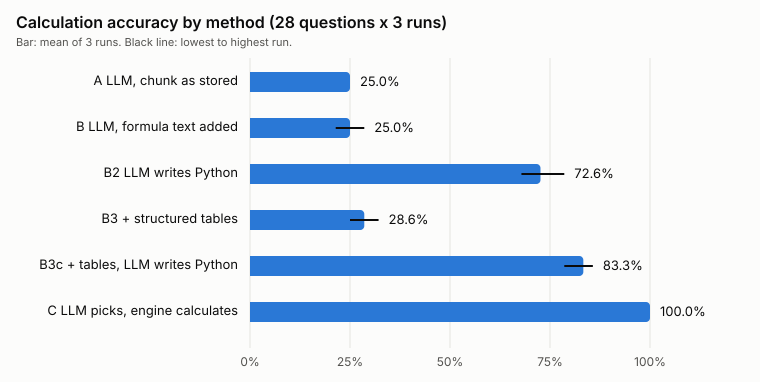
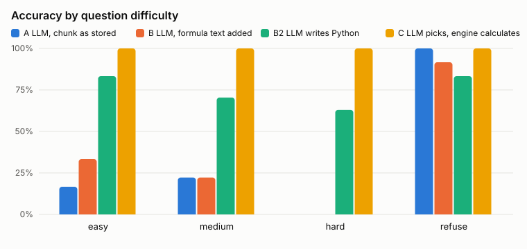

# 계산 방식 비교

- 계산 문제 28개(eval/calc_questions.jsonl) x 3회, 정답과 1% 이내면 맞음
- A, B, B2에는 공식 6개에 필요한 규정 발췌문 15개를 모두 줬다 (검색 오류의 영향 제외)
- 거부 문제 4개: 값이 빠졌거나 적용 범위 밖이라 계산하면 안 되는 문제

| 조건 | 방식 | 전체 (회차 최저~최고) | easy | medium | hard | refuse | 근거 조항 정확 | 지어낸 값 | 오류 | 평균 시간(초) |
|---|---|---|---|---|---|---|---|---|---|---|
| A | LLM calculates from rule excerpts as stored (formulas missing) | 25.0% (25~25) | 16.7% | 22.2% | 0.0% | 100.0% | 66.7% | 0/12 | 0 | 1.8 |
| B | LLM calculates from rule excerpts with formulas added as text | 27.4% (25~29) | 33.3% | 22.2% | 0.0% | 91.7% | 86.1% | 1/12 | 0 | 1.9 |
| B2 | LLM writes Python code from rule excerpts with formulas added | 72.6% (71~75) | 83.3% | 70.4% | 63.0% | 83.3% | 94.4% | 0/12 | 5 | 2.8 |
| C | LLM selects function and inputs, verified Python engine calculates | 100.0% (100~100) | 100.0% | 100.0% | 100.0% | 100.0% | 100.0% | 0/12 | 0 | 1.6 |

